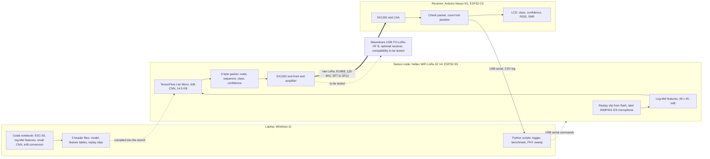

# HushNet proof of concept: a tiny sound classifier whose result travels over raw LoRa

One Arduino sketch for two boards, one Colab notebook, a few Python scripts.

- **Heltec WiFi LoRa 32 V4** (PCB marked HTIT-WB32LAF V4.3, ESP32-S3 + SX1262)
- **Arduino Nesso N1** (ESP32-C6 + SX1262)
- **Waveshare USB-TO-LoRa-HF (B)** (optional, compatibility is an open question, see step 7)

Neither board has a microphone yet, so the node works in **replay mode**: 8 one-second test clips
are stored in flash, the board computes the features and runs the model on them exactly as it would
on microphone audio, then sends a 6 byte result over LoRa (raw LoRa, not LoRaWAN).

---

## 0. Status: what was checked here and what only your hardware can show

I have no boards, so everything below marked "PC" was verified on a PC only.

| Item | Status |
|---|---|
| Training notebook runs end to end (ESC-50, TensorFlow 2.21) | PC, done |
| int8 model, 14 864 bytes, 4 036 parameters | PC, done |
| Feature code of the firmware (`hn_features.h`) against NumPy | PC, identical on all 8 replay clips (0 of 1 960 values differ) |
| Inference path of the firmware (`hn_inference.h` + the same TensorFlow Lite Micro library sources) against the notebook | PC, int8 scores identical on all 8 clips |
| Sketch compiles for `Heltec WiFi LoRa 32(V4)` and `Arduino Nesso N1`, ESP32 core 3.3.13 | PC, see section 10 for sizes and library versions |
| Python scripts (logger, benchmark, sweep, Waveshare helper) | PC, run against a simulator of the serial protocol (for the Waveshare helper an invented stand-in for the dongle) |
| Anything radio: SX1262 start-up, TCXO voltage, front end pins, output power, RSSI, range | **not tested, needs your boards** |
| Timing and memory on the boards (S3 against C6) | **not tested**, only estimated |
| Display code on the Nesso N1, charging, LED | **compiles, not tested** |
| Waveshare dongle interoperability | **unknown**, the script in step 7 finds out |

Do the steps in section 5 in order and stop at the first one that fails. Send me the serial output and
I will fix it from there.

---

## 1. Device roles and block diagram

| Device | Role in the proof of concept | Why |
|---|---|---|
| Heltec WiFi LoRa 32 V4 (ESP32-S3) | **Sensor node**: features, model, LoRa transmit | Dual core 240 MHz with a floating point unit, 2 MB PSRAM, and it is the board that gets the INMP441 microphone later |
| Arduino Nesso N1 (ESP32-C6) | **Receiver / small gateway** with display. Also runs the same model for the S3 against C6 benchmark | Screen and battery make it a good portable receiver. Single core 160 MHz without floating point unit, so it shows what a cheaper node costs in time |
| Waveshare USB-TO-LoRa-HF (B) | Optional third receiver on the laptop | Only if step 7 shows that it can decode the packets. The vendor says it only talks to its own product family |

Both boards run the same sketch, so the roles can be swapped at any time with one command
(`MODE RX`, `MODE NODE`). That gives you both link directions and both boards in the benchmark.



The same diagram is in `docs/block_diagram.mmd`. Paste it into the Mermaid Live Editor to get an SVG or PNG for slides.

---

## 2. What is in this folder

```
firmware/01_hello/01_hello.ino        step 1: LED and serial test, both boards
firmware/hushnet_poc/                 the proof of concept sketch (open hushnet_poc.ino)
    hushnet_poc.ino                   commands, packet format, modes
    hn_config.h                       settings you may want to change
    hn_board.h, hn_ui.h               board detection, console, LED, display
    hn_radio.h                        SX1262 with RadioLib, front end, power, receive, transmit
    hn_features.h                     log-Mel features in plain C++
    hn_inference.h                    TensorFlow Lite Micro wrapper
    hn_model_data.h                   GENERATED: the int8 model
    hn_feature_params.h               GENERATED: window, Mel tables, quantisation constants
    hn_replay_clips.h                 GENERATED: 8 test clips and the PC results for them
notebook/hushnet_train.ipynb          Colab notebook (hushnet_train.py is the same code as a script)
tools/pc/                             Python scripts for the PC (Windows is fine)
    serial_logger.py                  serial monitor + CSV log
    benchmark.py                      S3 against C6 table
    phy_sweep.py, toa.py              LoRa PHY sweep and the Semtech airtime formula
    waveshare_at.py                   Waveshare dongle: AT setup and interoperability experiment
    sim_boards.py                     simulated boards to try the scripts without hardware (Linux/WSL)
tools/host_test/                      optional PC test of the firmware maths (Linux/WSL, g++)
docs/block_diagram.mmd                Mermaid source of the diagram above
docs/training_log.txt, training_summary.json, feature_examples.png, hushnet_int8.tflite
                                      output of the training run that produced the model
```

---

## 3. Install on Windows 11

Windows is enough for everything that touches the boards. WSL is only needed for the optional
PC test in `tools/host_test` and for the simulator.

### 3.1 Arduino IDE and board package

1. Install **Arduino IDE 2** (2.3 or newer) from arduino.cc.
2. **Tools > Board > Boards Manager**, search `esp32`, choose **esp32 by Espressif Systems** and
   select version **3.3.13** in the version list, then Install. (That is the version I compiled with.
   Newer versions may work but I did not try them. The Nesso N1 needs 3.3.5 or newer.)
   If the download times out, see the troubleshooting section.

### 3.2 Libraries (Tools > Manage Libraries)

| Library (search for this name) | Version I compiled with | Needed for |
|---|---|---|
| RadioLib (by Jan Gromes) | **7.8.1** recommended. 8.0.0 also compiles (the sketch handles both) | both boards |
| Chirale_TensorFLowLite | 2.0.0 | both boards |
| Arduino_Nesso_N1 | 1.0.0, answer "Install all" so that M5GFX (0.3.0) and Arduino_BMI270_BMM150 (1.2.4) come with it | Nesso N1 only |
| U8g2 | 2.37.1 | only if you set `USE_HELTEC_OLED 1` |

Why RadioLib 7.8.1: version 8.0.0 came out on 7 November 2026 and changed `begin()` and the units of
frequency and bandwidth. The sketch compiles with both, but the vendor examples for the Nesso N1 are
written for 7.x and will not compile with 8.0.0, so 7.8.1 is the less surprising choice.

Do **not** install `TensorFlowLite_ESP32`: version 1.0.0 does not compile with ESP32 core 3.3.13
(error in `flatbuffers/stl_emulation.h`), and if both TensorFlow libraries are installed the IDE may
pick the wrong one.

### 3.3 Python for the PC scripts

1. Install Python 3 (python.org installer, tick "Add python.exe to PATH").
2. In a terminal: `py -m pip install pyserial matplotlib`

### 3.4 Drivers

None. Both boards use the native USB port of the ESP32 (USB serial/JTAG), which Windows 10 and 11
support out of the box. Each board shows up as a COM port.

---

## 4. Board settings, COM ports, upload

### 4.1 Tools menu

**Heltec** (Tools > Board > esp32 > **Heltec WiFi LoRa 32(V4)**):

| Menu entry | Value |
|---|---|
| USB CDC On Boot | **Enabled** (default is Disabled; the sketch prints over USB either way, but library error messages only reach the Serial Monitor with Enabled) |
| USB Mode | Hardware CDC and JTAG (default) |
| Upload Mode | UART0 / Hardware CDC (default) |
| LoRa FEM Type | **USE_KCT8103L_PA** (your PCB is marked V4.3). The sketch does not depend on this menu, it uses `HELTEC_FEM` in `hn_config.h`, which is already set to the KCT8103L |
| PSRAM | Disabled (default, not needed here) |
| Flash Size, Partition Scheme, CPU Frequency | defaults (4 MB setting, 1.2 MB app, 240 MHz). The sketch uses about 57 % of the app space |

**Nesso N1** (Tools > Board > esp32 > **Arduino Nesso N1**): leave every entry at its default.

### 4.2 Which COM port is which

Both boards report the same USB identity, so the IDE cannot tell them apart by name.
Plug in one board at a time, look at **Tools > Port**, and write the COM number on a sticker.
`py tools\pc\serial_logger.py --list` lists the ports as well.

### 4.3 Upload

Select board and port, press Upload. Normally the IDE puts the board into download mode by itself.
If the upload does not start:

- **Heltec**: hold the PRG button (also called USER, it is GPIO0), tap RST, release PRG. Upload, then tap RST to start the sketch.
- **Nesso N1**: long press the power button until it enters download mode. Upload, then click the power
  button once to restart. (Click = on or reset, double click = off, long press = download mode.)

The first build of `hushnet_poc` takes 5 to 15 minutes because the TensorFlow library has about 200
source files. Later builds only recompile the sketch.

When RadioLib is used with "USB CDC On Boot: Enabled" the compiler prints
`#warning "Use of USB CDC for debug output is not recommended"`. That is harmless.

### 4.4 Antennas first

Attach the LoRa antenna to **both boards and the dongle before powering them**. On the Nesso N1 the
antenna slides out of the compartment on the back. Transmitting without an antenna can damage the
radio; the Arduino manual and pinout sheet both say so for the Nesso.

---

## 5. Test checklist

Use the Arduino Serial Monitor (115200 baud, any line ending) or
`py tools\pc\serial_logger.py COM5`. Only one program can hold a port, so close the Serial Monitor
before starting a Python script.

Put the boards **2 to 3 m apart** for all desk tests. Closer than that the receiver can overload
and RSSI and SNR stop being meaningful.

### Step 1. Hello (toolchain, upload, serial)

Upload `firmware/01_hello` to each board.

Expected: the LED blinks once per second and the monitor shows one line per second, for example

```
hello 12 chip=ESP32-S3 rev=... cores=2 cpu=240MHz flash=16MB psram=0KB free_heap=... cdc_on_boot=1
hello 12 chip=ESP32-C6 rev=... cores=1 cpu=160MHz flash=16MB psram=0KB free_heap=... cdc_on_boot=1
```

Pass: both boards print, flash says 16 MB. (PSRAM shows 0 because it is disabled in the Tools menu.)

### Step 2. LoRa link without machine learning (ping)

Upload `firmware/hushnet_poc` to **both** boards (same sketch, just change board and port).
Open a monitor on each. After a reset each board prints its start-up report. You can ask for it
again at any time with `INFO`.

Expected on the Heltec:

```
BOOT board="Heltec WiFi LoRa 32 V4" tag=S3 fw=0.1 node=1 saved_settings=0
RADIO_OK fem=KCT8103L fem_detected=KCT8103L tcxo_v=1.8
ML_OK model_bytes=14864 arena_used=...
CFG freq=868100000 bw=125000 sf=7 cr=5 sync=0x12 pre=8 pwr=4 chip_pwr=-9 crc=1 iq=0 lna=0 len=20 toa_us=... duty_pct=1.0 band="865-868.6 MHz, 1 %"
READY mode=IDLE (send HELP for commands)
```

Expected on the Nesso N1: `RADIO_OK fem=none fem_detected=none tcxo_v=3.0`, `pwr=4 chip_pwr=4`,
`READY mode=RX`, and the screen shows `HushNet RX n2` and `868.100 SF7 4dBm`.

Check three things before going on:

1. `RADIO_OK` on both. If you see `RADIO_FAIL`, go to troubleshooting.
2. On the Heltec `fem=KCT8103L` and `fem_detected=KCT8103L` agree, and `chip_pwr` is 13 dB below `pwr`.
3. No `WARN` line.

Then type on the **Heltec**:

```
PING 5
```

Expected on the Heltec (numbers will differ):

```
PING seq=0 reply=1 from=2 rtt_ms=85 rssi_here=-38.0 snr_here=11.25 ferr_hz=-1420 rssi_there=-41 snr_there=10.50
...
PING_END sent=5 replies=5
```

and on the Nesso `RX type=ping ...` followed by `TX type=pong ...`. `rssi_here` is what the Heltec
measured for the answer, `rssi_there` is what the Nesso measured for the ping, so one command checks
both directions. Now swap: type `MODE RX` on the Heltec, `MODE IDLE` and then `PING 5` on the Nesso.

Pass: 5 of 5 replies in both directions. A frequency error (`ferr_hz`) of a few hundred Hz up to a
few kHz with a stable sign is normal for two different oscillators.

Afterwards put the boards back: `MODE RX` on the Nesso, `MODE IDLE` on the Heltec.

### Step 3. Inference on the replay clips (no radio involved)

Type on each board:

```
INFER
```

Expected: 8 `INFER` lines and one summary, for example

```
INFER clip=3 src=5-170338-B-41.wav@2.0s true=chainsaw pred=chainsaw conf=0.922 correct=1 pc_pred=chainsaw same_as_pc=1 feat_ms=... infer_ms=... feat_ndiff=0 feat_maxdiff=0 score_maxdiff=0 heap_free=...
INFER_SUMMARY board=S3 clips=8 correct=7 same_as_pc=8 feat_ms_avg=... infer_ms_avg=... total_ms_avg=... arena_used=... model_bytes=14864 ...
```

What to look at:

- `same_as_pc=8`: the board decides exactly like the PC did. This is the real pass criterion.
- `correct=7`: one clip (clip 1, a wind recording) is classified as birds by the model on the PC as
  well. That is a model error, not a firmware error, and it is left in on purpose.
- `feat_maxdiff` and `score_maxdiff`: 0 on the PC test. On the boards a difference of 1 in a few values
  is possible because the maths library is a different one. Larger differences mean something is wrong.

Reference values from the PC (int8 scores for background, chainsaw, fire, birds):

| Clip | True | Predicted | Confidence | Scores |
|---|---|---|---|---|
| 0 | background | background | 0.934 | 111 -126 -121 -120 |
| 1 | background | birds | 0.879 | -111 -115 -127 97 |
| 2 | chainsaw | chainsaw | 0.395 | -80 -27 -122 -27 |
| 3 | chainsaw | chainsaw | 0.922 | -119 108 -121 -124 |
| 4 | fire | fire | 0.895 | -105 -126 101 -125 |
| 5 | fire | fire | 0.969 | -121 -128 120 -128 |
| 6 | birds | birds | 0.996 | -128 -128 -128 127 |
| 7 | birds | birds | 0.984 | -124 -128 -128 124 |

### Step 4. Inference result over LoRa

Nesso in `MODE RX` (its default), Heltec idle. On the Heltec:

```
SEND 3
```

Expected on the Heltec: one `INFER` line, then
`TX type=cls seq=0 class=1 name=chainsaw conf=0.922 len=6 toa_meas_us=... hex=4801000001EB`

Expected on the Nesso:
`RX type=cls node=1 seq=0 class=1 name=chainsaw conf=0.922 len=6 rssi=... snr=... ferr_hz=... lost=0 ... hex=4801000001EB`
and on its screen: `n1 #0`, `chainsaw 92%`, RSSI and SNR, and the counters.

The 6 bytes are: `48` marker, `01` node, `0000` sequence number, `01` class, `EB` confidence (235/255).

Continuous operation: `MODE NODE` on the Heltec classifies the next replay clip every 10 s and sends
it. `MODE IDLE` stops it. (At SF7 that is 0.36 % duty cycle. At SF12 on 868.1 MHz the board stops
after 36 packets with `TX_BLOCKED`, because the hour's 1 % is used up. That is the guard working.) Then swap roles (`MODE NODE` on the Nesso, `MODE RX` on the Heltec) to see
the C6 as node.

Pass: every packet sent appears on the receiver with the same class and `lost=0`.

### Step 5. S3 against C6 benchmark table

Close the monitors, then

```
py tools\pc\benchmark.py COM5 COM6
```

It runs `INFO` and `INFER` on both boards, writes `benchmark.csv` and prints a Markdown table with
accuracy, agreement with the PC, feature time, inference time, model size, arena and heap.

What I expect, **as an estimate from operation counts, not a measurement**: the S3 needs a few tens
of ms for the features and around 0.1 s for the model. The C6 has no floating point unit, so the
float feature code should be many times slower there (several hundred ms), while the int8 model
should take about 1.5 to 2 times as long as on the S3. If the C6 needs close to 1 s per 1 s window,
that is a result for the thesis (it argues for fixed point features or for the S3), not a bug.

### Step 6. LoRa PHY sweep (Mobile Communications course)

Both boards on the laptop, monitors closed:

```
py tools\pc\phy_sweep.py --tx COM5 --rx COM6 --note "lab, 3 m, stock antennas"
```

Defaults: 869.525 MHz, 125 kHz, coding rate 4/5, 20 byte payload, SF7 to SF12, powers 4, 9, 14 dBm,
30 packets per setting. That is 250 s of transmit time, inside the 360 s per hour that the
869.4 to 869.65 MHz sub-band allows (10 % duty cycle), and the run takes about 6 minutes.

Outputs: `sweep_packets.csv` (one row per packet), `sweep_summary.csv` (one row per setting: sent,
received, PER, RSSI, SNR, frequency error, measured airtime, RadioLib airtime, Semtech formula
airtime), `sweep.png` (four plots) and `sweep_raw.log`.

Airtime from the Semtech formula, 125 kHz, 4/5, preamble 8, CRC on (`py tools\pc\toa.py --len 20`):

| SF | 20 byte test packet | 6 byte class packet | Class packets per hour at 1 % |
|---|---|---|---|
| 7 | 56.6 ms | 36.1 ms | 997 |
| 8 | 102.9 ms | 61.9 ms | 581 |
| 9 | 185.3 ms | 123.9 ms | 290 |
| 10 | 370.7 ms | 247.8 ms | 145 |
| 11 | 741.4 ms | 495.6 ms | 72 |
| 12 | 1318.9 ms | 991.2 ms | 36 |

The measured airtime runs from "transmission started" to the "TX done" interrupt of the SX1262. It
should sit slightly above the formula (amplifier ramp, interrupt latency). I could not measure this
offset; report what you see.

At 3 m every setting will give 0 % packet loss. To see the spreading factor matter you need a weak
link: more distance, walls, or lower power (the Nesso can go down to -9 dBm, the Heltec V4.3 not
below about 4 dBm). **Never** weaken the link by removing an antenna.

Range walk without a second laptop: on the Nesso type `CFG freq=869.525 sf=9 pwr=14`, `MODE BEACON`,
`SAVE`. It now sends a numbered 20 byte packet every 10 s, also on battery after a restart. On the
Heltec type `CFG freq=869.525 sf=9` and `MODE RX`, close the monitor and start
`py tools\pc\serial_logger.py COM5 --csv walk.csv`. Each `RX` line carries the sequence number, RSSI,
SNR and the running `lost` count. `FACTORY` on the Nesso undoes the saved mode.

### Step 7 (optional). Waveshare USB-TO-LoRa-HF (B)

The Waveshare wiki says the dongle does not support LoRaWAN and "only supports" its own
SX1262-LoRa-DTU family. It does not document the frame it sends, the sync word, or the replies to
AT commands. So I cannot promise that it receives the HushNet packets. The experiment:

```
py tools\pc\waveshare_at.py setup COM7
py tools\pc\waveshare_at.py probe COM7 --board COM5
```

`setup` first sets **AT+PWR=10** (factory default is 22 dBm, far above the EU limit with its
antenna), then SF7, 125 kHz, 4/5, channel 18 (868 MHz), stream mode. Check the printed replies: if
`AT+PWR=10` is not acknowledged, do not transmit with the dongle.

`probe` then (1) lets the dongle transmit a text while the board listens with sync word 0x12 and
0x34 and both IQ settings, (2) lets the board send HushNet packets while the dongle listens, (3)
replays the captured dongle frame from the board. It prints one of three results: usable as a
receiver as is, usable only if the HushNet payload is wrapped in the dongle's own frame, or not
usable. If step 1 finds nothing, run it again with `--scan-sync` (all 256 one byte sync words,
about 5 minutes).

Until that experiment says otherwise, treat the dongle as not part of the chain. The two boards are
enough for every other step.

---

## 6. Training notebook (Colab)

1. Open colab.research.google.com, File > Upload notebook, choose `notebook/hushnet_train.ipynb`.
2. Runtime > Run all. About 5 to 10 minutes on a free CPU runtime.
3. The last cell downloads `hushnet_export.zip`. Copy the three files `hn_model_data.h`,
   `hn_feature_params.h`, `hn_replay_clips.h` into `firmware/hushnet_poc/`, always all three together,
   and upload the sketch again.

What the notebook does: ESC-50 download, four classes (`background` = rain + wind, `chainsaw`,
`fire` = crackling fire, `birds` = chirping birds), 1 s windows at 16 kHz, log-Mel features
(512 point Hann window, hop 320, 40 Mel bands from 50 Hz to 8 kHz, natural log, window mean removed),
a depthwise separable CNN, full int8 quantisation, test with the reference kernels, export.

Results of the run that produced the files in this folder (TensorFlow 2.21, seed 7):

| | Value |
|---|---|
| Training data | ESC-50 folds 1 to 4: 2 705 windows from 160 clips |
| Test data | ESC-50 fold 5 (never used for any choice): 358 windows from 40 clips |
| Model | 4 036 parameters, 14 864 bytes as int8 TensorFlow Lite |
| Float model, window accuracy | 0.863 |
| int8 model, window accuracy | 0.869 |
| int8 model, clip accuracy (majority vote over the windows of a 5 s clip) | 0.900 (36 of 40) |

Confusion matrix of the int8 model on the test windows (rows true, columns predicted):

| | background | chainsaw | fire | birds |
|---|---|---|---|---|
| background | 106 | 5 | 15 | 18 |
| chainsaw | 5 | 64 | 0 | 2 |
| fire | 2 | 0 | 70 | 0 |
| birds | 0 | 0 | 0 | 71 |

Model choice by 4-fold cross-validation inside folds 1 to 4 (window accuracy, mean and standard
deviation over the folds):

| Width | Mixup | Parameters | Accuracy |
|---|---|---|---|
| 16, 32, 64 | no | 4 036 | 0.890 +- 0.022 |
| 24, 48, 96 | no | 7 972 | 0.899 +- 0.019 |
| **16, 32, 64** | **0.3** | **4 036** | **0.898 +- 0.009** (used) |
| 24, 48, 96 | 0.3, dropout 0.4, label smoothing 0.05 | 7 972 | 0.909 +- 0.011 |

Read these numbers with care: the test set is 40 clips, so one clip is 2.5 points of clip accuracy,
and the background class (rain and wind) is clearly the weak one. The clips are curated recordings,
not what an INMP441 in a forest will deliver. This model is good enough to prove the pipeline, not
to make claims about detection in the field.

Datasets:

- **ESC-50**: 2 000 clips of 5 s, 50 classes with 40 clips each, 44.1 kHz mono WAV, 5 folds with
  clips from the same source recording kept in one fold. Licence CC BY-NC 3.0 (non-commercial), which
  is fine for a thesis. Cite K. J. Piczak, "ESC: Dataset for Environmental Sound Classification",
  ACM Multimedia 2015, doi:10.1145/2733373.2806390. The replay clips inside `hn_replay_clips.h` are
  ESC-50 audio and carry the same licence.
- **FSC22** (forest sounds, 2 025 clips of 5 s, 27 classes, 75 clips per class, collected from
  Freesound, DOI 10.21227/40ds-0z76) is the more relevant dataset for the thesis, but I could not
  confirm its licence terms or its sample rate from the pages I could reach, and I could not download
  it here. I did not use it. Check both points before you build on it.

---

## 7. Reference

### 7.1 Serial commands (115200 baud, one per line, upper or lower case)

| Command | What it does |
|---|---|
| `HELP` | list of commands |
| `INFO` | board, radio, model, settings, counters |
| `CFG key=value ...` | change radio settings, for example `CFG sf=9 pwr=14` or `CFG freq=869.525`. Keys: `freq` (Hz or MHz), `bw` (Hz or kHz: 62.5, 125, 250, 500), `sf` 7..12, `cr` 5..8, `pwr` (dBm at the antenna, clamped to what the board can do and to 14), `sync` (0x12), `pre`, `crc` 0/1, `iq` 0/1, `lna` 0/1 (Heltec V4.3 receive amplifier), `len` (test packet bytes, 6..200). `CFG` alone prints the settings |
| `MODE IDLE` / `RX` / `NODE` / `BEACON` | idle, print every received packet, classify a replay clip and send it every 10 s, send a numbered test packet every 10 s |
| `INFER` or `INFER n` | classify all replay clips or clip n and compare with the PC results |
| `SEND n` | classify clip n and send the result once |
| `TX n [gap_ms]` | send n numbered test packets (any typed character stops the burst) |
| `PING n` | send n pings and wait for the answers of a board in `MODE RX` |
| `RAW hexbytes` | send these bytes once without the HushNet header |
| `STAT` / `STAT RESET` | counters, transmit time used in the last hour |
| `SAVE` / `FACTORY` | keep settings and mode over power cycles / back to the defaults |

Both boards must have the same `freq`, `bw`, `sf`, `cr`, `sync`, `iq`, `crc` to hear each other.

### 7.2 Output lines

Every line starts with a tag followed by `key=value` pairs: `BOOT`, `RADIO_OK`, `RADIO_FAIL`,
`ML_OK`, `ML_FAIL`, `CFG`, `MODE`, `STAT`, `INFO`, `INFER`, `INFER_SUMMARY`, `TX_BEGIN`, `TX`,
`TX_END`, `TX_BLOCKED`, `TX_ERR`, `RX`, `PING`, `PING_END`, `WARN`, `ERR`.
`RX type=` is `cls` (class packet), `test`, `ping`, `pong`, `crc_error`, or `other` (a LoRa frame that
is not a HushNet packet, printed as hex).

### 7.3 Packet format

| Byte | Content |
|---|---|
| 0 | 0x48 marker |
| 1 | node id (1 = Heltec, 2 = Nesso, set in `hn_config.h`) |
| 2, 3 | sequence number, low byte first |
| 4 | type: 0 to 3 = class index (background, chainsaw, fire, birds), 0xFF test, 0xFE ping, 0xFD pong |
| 5 | class packet: confidence 0..255. Test packet: burst number. Pong: RSSI seen by the replier in dBm |
| 6.. | pong: SNR in quarter dB. Test packet: filler up to `len` |

### 7.4 Power, duty cycle and bands in the firmware

- `pwr` is the wanted power at the antenna connector. On the Heltec V4.3 the firmware subtracts 13 dB
  for the front end amplifier before programming the SX1262 (`chip_pwr`). The usable range is therefore
  about 4 to 14 dBm on the Heltec V4.3 and -9 to 14 dBm on the Nesso.
- The firmware refuses to transmit when the channel is not inside one of these sub-bands and when the
  transmit time of the last 60 minutes would exceed the limit: 863 to 865 MHz 0.1 %, 865 to 868.6 MHz
  1 %, 868.7 to 869.2 MHz 0.1 %, 869.4 to 869.65 MHz 10 %, 869.7 to 870 MHz 1 %. The counter starts
  from zero after a reset, so do not use resets to get around it.

---

## 8. Known risks

1. **Antenna.** Never transmit without one (section 4.4).
2. **Heltec V4.3 output power.** The V4.3 has a KCT8103L front end whose amplifier is always in the
   transmit path. Meshtastic's gain table gives +13 dB for low drive levels. A sketch that simply
   sets "14 dBm" on the SX1262 would radiate about 26 dBm (400 mW), 16 times the 25 mW limit. This
   firmware compensates, and it assumes the +13 dB whenever either the setting or the boot test points
   to the KCT8103L, so a wrong setting can only make the signal weaker. The gain value is taken from
   the Meshtastic source, I did not measure it. If you get access to a spectrum analyser or power
   meter, check 4 dBm and 14 dBm once.
3. **EU868 limits.** 25 mW ERP (14 dBm) and 1 % duty cycle in 865 to 868.6 MHz; 10 % only in
   869.4 to 869.65 MHz. At SF12 a 6 byte class packet is 0.99 s on air: 36 packets per hour at 1 %.
   This is a core number for the thesis argument about message size.
4. **Waveshare dongle power.** Factory default 22 dBm. Run `waveshare_at.py setup` before it transmits.
5. **Receiver overload at short range.** Keep 2 to 3 m distance, use 4 dBm, leave `lna=0` on the
   Heltec for desk tests. With `lna=1` the Heltec reports RSSI roughly 21 to 25 dB higher than the
   signal at the antenna (datasheet gain 21 dB, Meshtastic measured 23 to 25 dB), so do not compare
   RSSI between the two settings without correcting for it.
6. **Nesso N1 radio settings.** The Arduino manual example starts the SX1262 with RadioLib defaults
   (TCXO 1.6 V, DC-DC regulator); M5Stack's example for the same board uses TCXO 3.0 V and the LDO
   regulator. The sketch uses M5Stack's values and falls back to 1.6 V, then to "crystal", if the
   radio does not start. `RADIO_OK tcxo_v=` tells you which one worked. I also assume there is no
   transmit amplifier on the Nesso: the user manual describes an RF switch (FM8625) and a receive LNA
   (SGM13005L4), while a table in the datasheet lists the FM8625H as receive LNA and the SGM13005L4 as
   transmit amplifier. I followed the user manual. If the Nesso looks much stronger than the Heltec at
   the same `pwr`, that assumption is wrong.
7. **ESP32-C6 limits.** Single RISC-V core at 160 MHz without floating point unit, 512 KB RAM. The
   feature extraction is float code, so expect it to dominate the C6 time. The model itself is int8.
8. **PSRAM.** Not used. The interpreter arena is 48 KB of internal RAM (28 KB used on the PC build),
   the feature buffers about 17 KB. Leave PSRAM disabled.
9. **Library versions.** Pinned in section 3.2. RadioLib 8.0.0 breaks older examples;
   `TensorFlowLite_ESP32` 1.0.0 does not build on core 3.3.13. The Chirale library uses portable C
   kernels on ESP32 (no ESP-NN acceleration), so inference is slower than it could be. ESP-DL on the
   S3 would be faster but would mean a second model format; not done here because the goal was the
   same model on both boards.
10. **Model validity.** Small test set, curated clips, no microphone in the loop (section 6).
11. **Display and charging on the Nesso.** `NESSO_ENABLE_CHARGING 1` calls the vendor library's
    default charger setup (256 mA), as in Arduino's example. Set it to 0 if you prefer not to touch
    the charger.

---

## 9. Troubleshooting

| Symptom | What to do |
|---|---|
| Boards Manager download fails or times out | Arduino's manual for the Nesso suggests: close the IDE, edit `C:\Users\<you>\.arduinoIDE\arduino-cli.yaml`, add `network:` / `connection_timeout: 300s`, restart |
| Serial Monitor stays empty (Heltec) | Right port? Press RST and send `INFO`. Set USB CDC On Boot: Enabled and upload again. Close other programs that hold the port |
| Upload fails ("No serial data received", port vanishes) | Manual download mode, section 4.3 |
| `Please include Arduino_Nesso_N1.h` | Install the Arduino_Nesso_N1 library |
| Compile error in `flatbuffers/stl_emulation.h` | `TensorFlowLite_ESP32` is installed and was picked. Remove it |
| Compile error in `hn_radio.h` about `begin` or `setFrequency` | RadioLib is neither 7.x nor 8.0.0. Install 7.8.1 |
| `RADIO_FAIL code=-2` | SX1262 not found over SPI. Wrong board selected in Tools, or on the Nesso the expander did not release the module. Power cycle, check the board selection |
| `RADIO_FAIL code=-707` or `-706` | Oscillator did not start with any of the tried TCXO voltages. Send me the line. You can change `HELTEC_TCXO_V` / `NESSO_TCXO_V` in `hn_config.h` |
| `WARN the front end setting ... disagree` | `HELTEC_FEM` in `hn_config.h` does not match what the board reports. Read the marking on the PCB (V4.2 or V4.3) and tell me |
| `ML_FAIL` | The text says why. "different training runs": copy all three generated headers together |
| `TX_ERR code=-5` | The radio never reported "transmit done" (interrupt line DIO1). Send me the `INFO` output |
| `PING` gets no replies | Other board in `MODE RX`? Same `CFG` on both (compare the `CFG` lines)? Antennas on? Try 3 m distance. Try `CFG lna=1` on the Heltec as a test |
| `TX_BLOCKED reason="duty cycle budget used"` | Wait (the budget is per hour) or move to `CFG freq=869.525` for tests |
| RSSI pinned around -20 dBm or packets lost at 30 cm | Receiver overload. Move apart, lower `pwr` |
| Python: `No module named serial` | `py -m pip install pyserial` |
| Python: cannot open COM port | Close the Arduino Serial Monitor |

---

## 10. Build facts

Compiled with arduino-cli 1.6.0 and ESP32 Arduino core 3.3.13 on Linux, default Tools settings unless
stated. The RadioLib version is given per row.

| Target | RadioLib | Program size | Global variables |
|---|---|---|---|
| `hushnet_poc`, Heltec V4, USB CDC On Boot enabled (clean build) | 7.8.1 | 742 840 bytes, 56 % of 1 310 720 | 92 360 bytes |
| `hushnet_poc`, Heltec V4, all Tools entries at default | 7.8.1 | 748 020 bytes, 57 % | 92 600 bytes |
| `hushnet_poc`, Nesso N1 (clean build) | 7.8.1 | 844 910 bytes, 26 % of 3 145 728 | 86 604 bytes |
| `hushnet_poc`, Heltec V4, USB CDC On Boot enabled | 8.0.0 | 742 284 bytes | 92 408 bytes |
| `hushnet_poc`, Heltec V4, defaults | 8.0.0 | 747 440 bytes | 92 648 bytes |
| `hushnet_poc`, Nesso N1 | 8.0.0 | 843 630 bytes | 86 652 bytes |
| `hushnet_poc`, Nesso N1, `USE_NESSO_DISPLAY 0` | 7.8.1 | 777 164 bytes | 85 692 bytes |
| `hushnet_poc`, Heltec V4, `USE_HELTEC_OLED 1` (U8g2 2.37.1) | 8.0.0 | 749 456 bytes | 93 624 bytes |
| `hushnet_poc`, `ENABLE_ML 0`, Heltec V4 / Nesso N1 | 8.0.0 | 348 176 / 457 032 bytes | 24 184 / 19 852 bytes |
| `01_hello`, Heltec V4 / Nesso N1 | none | 268 959 / 305 234 bytes | 21 776 / 16 696 bytes |

The global variables include the 48 KB interpreter arena. A clean build took about 6 minutes per
board on a Linux server; expect longer on a laptop. Compiling proves that the code and the library
versions fit together, nothing more.

Optional PC test (`tools/host_test/run_host_test.sh`, Linux or WSL with g++): builds the feature code
and the inference path of the firmware for the PC and compares with the notebook. Result here:
features identical on all clips, scores identical on all clips, 7 of 8 correct (same as the
notebook), arena 28 288 bytes (64 bit PC; expect a smaller number on the boards).

---

## 11. Sources

Hardware and library facts used in the firmware, with where they come from:

- Heltec WiFi LoRa 32 V4 pins (SS 8, SCK 9, MOSI 10, MISO 11, RST 12, BUSY 13, DIO1 14, LED 35, Vext 36,
  OLED SDA 17 / SCL 18 / RST 21), Tools menu entries: ESP32 Arduino core 3.3.13,
  `variants/heltec_wifi_lora_32_V4/pins_arduino.h` and `boards.txt`, https://github.com/espressif/arduino-esp32
- Heltec V4 product page and hardware update log (V4.3.1: KCT8103L, software controlled LNA path,
  GPIO5 is the FEM control pin, GPIO46 freed, maximum 28 dBm):
  https://wiki.heltec.org/docs/devices/open-source-hardware/esp32-series/lora-32/wifi-lora-32-v4/ and
  https://wiki.heltec.org/docs/devices/open-source-hardware/esp32-series/lora-32/wifi-lora-32-v4/hardware-update-log
- Heltec V4 front end control (GPIO7 supply, GPIO2 enable and detection, GPIO5 LNA/bypass, GPIO46 on
  V4.2, TCXO 1.8 V, DIO2 as RF switch, gain tables, LNA gain): Meshtastic firmware,
  `variants/esp32s3/heltec_v4/variant.h` and `src/mesh/LoRaFEMInterface.cpp`, commit d361d3d,
  https://github.com/meshtastic/firmware
- Arduino Nesso N1 pins (LORA_CS 23, LORA_IRQ 15, LORA_BUSY 19, SCK 20, MOSI 21, MISO 22, expander
  pins LORA_ENABLE, LORA_ANTENNA_SWITCH, LORA_LNA_ENABLE, LED, LCD), power button, LoRa example,
  antenna warning, core version 3.3.5: Arduino user manual and datasheet,
  https://docs.arduino.cc/hardware/nesso-n1 (source files in https://github.com/arduino/docs-content,
  `content/hardware/kits/maker/nesso-n1`), https://docs.arduino.cc/resources/datasheets/TPX00227-datasheet.pdf,
  https://docs.arduino.cc/resources/pinouts/TPX00227-full-pinout.pdf, core variant
  `variants/arduino_nesso_n1/pins_arduino.h`
- Arduino_Nesso_N1 library 1.0.0 (display, expander, battery): https://github.com/arduino-libraries/Arduino_Nesso_N1
- M5Stack LoRa example for the Nesso N1 (reset pulse, LNA and switch pins, TCXO 3.0 V, LDO):
  https://docs.m5stack.com/en/arduino/arduino_nesso_n1/lora
- RadioLib 7.8.1 and 8.0.0 source and release notes: https://github.com/jgromes/RadioLib/releases
- TensorFlow Lite Micro for Arduino: Chirale_TensorFLowLite 2.0.0, https://github.com/spaziochirale/Chirale_TensorFlowLite
- Waveshare USB-TO-LoRa-xF wiki (AT commands, defaults, 22 dBm, channel 18 = 868 MHz, "only supports"
  its own family, no LoRaWAN): https://www.waveshare.com/wiki/USB-TO-LoRa-xF
- EU 863 to 870 MHz sub-bands and duty cycles (ETSI EN 300 220-2 bands K to Q, CEPT ERC/REC 70-03):
  summary at https://thethingsnetwork.org/docs/lorawan/regional-parameters/eu868, ERC decision
  https://docdb.cept.org/download/2369
- LoRa time on air: Semtech AN1200.13 "LoRa Modem Designer's Guide" and the SX1261/2 data sheet
  (section on LoRa time on air). No link here because I did not open them in this session; the
  formula in `toa.py` reproduces the usual reference values (56.6 ms for 20 bytes at SF7, 125 kHz, 4/5).
- ESP32-C6 has no floating point unit: the core builds it with `-march=rv32imac_zicsr_zifencei`;
  ESP32-S3 has `SOC_CPU_HAS_FPU 1` (ESP-IDF headers shipped with core 3.3.13). Datasheet:
  https://documentation.espressif.com/esp32-c6_datasheet_en.pdf
- ESC-50: https://github.com/karolpiczak/ESC-50 . FSC22: https://ieee-dataport.org/node/9823 and
  https://www.mdpi.com/1424-8220/23/4/2032
